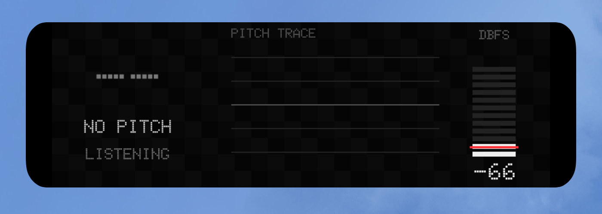

# 点阵音高监视器

Nothing 风格的 Android `3×1` 实时桌面组件，显示当前音名、频率、音分偏差、约 4.8 秒的音高轨迹，以及实时与短时峰值 dBFS。



- 使用 `AudioRecord` 采集麦克风 PCM，YIN 算法估计人声或乐器基频。
- 音频以约 21 FPS 分析，桌面最多 10 FPS 更新，避免每个采样事件跨 Binder 推送位图。
- dBFS 与音高复用同一帧：白色为正常、黄色为较强、红色为接近削波。
- 手机麦克风未经声压校准，因此默认显示 dBFS，不冒充专业声级计的 dB SPL。
- 点击组件通过透明无动画入口开始或停止监听，不切换到普通全屏页面；第一次使用必须在应用内授予麦克风权限。

## 构建与安装

```sh
sh build.sh
adb install -r build/pitch-monitor.apk
```

安装后先打开应用授予麦克风权限，再将 `3×1` 组件添加到桌面。
